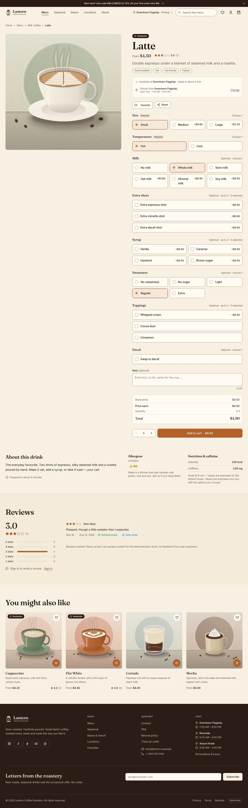
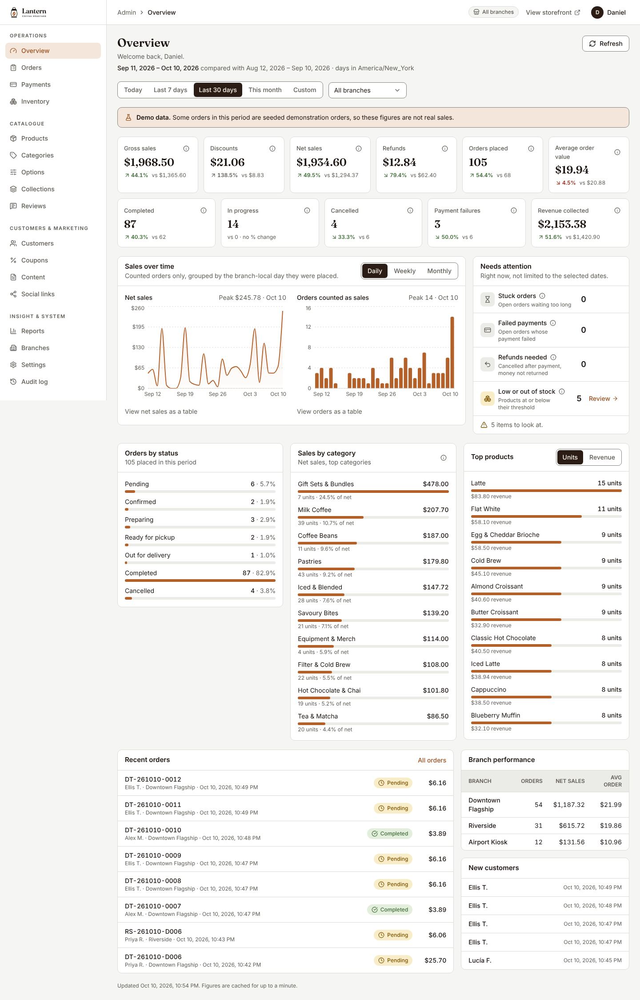

# Lantern Coffee Roasters — a coffee-commerce platform

A full-stack, multi-branch coffee-shop commerce system: a premium storefront with customisable drinks, server-priced
checkout, order tracking and customer accounts — plus a role-based operations dashboard for orders, payments and
refunds, catalogue, inventory, branches, promotions, content and reports. **Lantern Coffee Roasters** is an original,
editable demo brand; every brand string, colour, contact detail and social link is configuration.

This repository is a ground-up rebuild of the legacy [`coffeeshop-website`](https://github.com/adhamhe6/coffeeshop-website)
Django project (audit: [`docs/legacy-analysis.md`](docs/legacy-analysis.md)). Nothing is shared with the old code except
domain knowledge; the old project stored raw card numbers and CVVs, this one never touches card data.

| Storefront (customise a drink with live server pricing) | Operations dashboard (real aggregates, defined metrics) |
|---|---|
|  |  |

More screenshots of the running product (storefront, customer, admin roles, mobile) are in
[`docs/screenshots/release`](docs/screenshots/release); regenerate them with `frontend/scripts/release-screenshots.mjs`.

## What is implemented

**Storefront** — editorial home page · menu with category rail, filters, sort and URL-synced state · typo-tolerant search with
autocomplete · product pages with required/optional modifier groups (size, temperature, milk, shots, syrups, toppings…),
**server-computed price breakdown before add-to-cart**, allergens/nutrition, reviews (eligibility + moderation; demo reviews
are labelled) · favourites (anonymous local storage, merged into the account on sign-in) · guest cart that merges on login ·
branch selector with branch-aware availability · locations, contact, about, FAQ, privacy, terms, refund policy (editable CMS
pages) · 404/error pages · SEO shell (per-page title, canonical, Open Graph, JSON-LD, sitemap, robots, noindex on private pages).

**Checkout & orders** — pickup or delivery, delivery zones with fees/minimums/free-over thresholds, branch hours and closures,
scheduled slots, coupons and automatic promotions, tax (configurable), full price breakdown before paying, idempotent
submission, `expected_total` guard (409 `price_changed`), stock reservation, order tracking with a pickup/delivery-aware
timeline, cancel, reorder, order history, in-app notifications and transactional email (Celery).

**Payments** — provider abstraction with: **Stripe** (official SDK, hosted Checkout, signed webhooks, retrieval-based
return sync, refunds), a clearly-labelled **sandbox** provider (no real money; goes through the same signed-event pipeline) and
**cash**. Webhooks are verified, idempotent and order-safe; a DB constraint blocks double settlement; refunds are verified
provider operations. See [`docs/payments.md`](docs/payments.md) for the honest operating-mode statement.

**Operations dashboard** (`/admin`, capability-gated, backend-enforced) — overview KPIs with previous-period deltas and metric
definitions · live order queue + searchable order table + order detail with state transitions, notes, cancellation (+real
refund outcome), printable ticket · payments & refunds · products (editor with images, modifier groups, preview, bulk
actions) · categories, option groups, collections · inventory (stock, movements, adjustments, per-branch "86 it") ·
branches (hours, closures, zones, pause orders) · reviews moderation · customers (suspend/restore) · staff & roles ·
coupons · homepage blocks, CMS pages, announcement bar, social links, newsletter list · store settings · reports with CSV
export · append-only audit log.

## Architecture

```
Browser ── React 19 + TypeScript + Vite + Tailwind 4 + TanStack Query ──┐  one origin
                                                                         ▼
              nginx (prod) / Vite proxy (dev):  /  /api  /media  /sitemap.xml  /robots.txt
                                                                         │
                  Django 5.2 LTS + DRF  (session auth + CSRF · service layer · state machines)
                        │                    │                       │
                  PostgreSQL 16 (truth)   Redis (cache, throttles, broker)   Celery worker + beat
                                           Stripe │ sandbox │ cash   ← payment providers
```

Why these choices: [`docs/implementation-plan.md`](docs/implementation-plan.md) §1 · domain rules, state machines, caching keys
and job lifecycle: [`docs/architecture.md`](docs/architecture.md) · API contract: `GET /api/v1/docs/` (Swagger UI) and
`/api/v1/schema/` (OpenAPI; the frontend's TypeScript types are generated from it).

Technology roles — Django/DRF: API + business rules · PostgreSQL: relational truth with constraints (unique, check, partial
unique) and row locks · Redis: cache/throttle/broker (the app degrades gracefully without it) · Celery: email, order expiry,
payment reconciliation · React/TS/Vite/Tailwind/Radix: storefront and admin SPA · Stripe SDK: card payments · pytest, Vitest,
Playwright: tests · Docker Compose + GitHub Actions: deployment and CI.

## Quick start

### Docker (production-style stack)

```bash
git clone https://github.com/adhamhe6/coffeeshop && cd coffeeshop
./deploy/init-env.sh            # copies .env.example → .env and generates secrets (never commit .env)
# optional: set SEED_DEMO=1 in .env to load the demo catalogue/users/orders on first boot
docker compose up --build       # storefront + admin: http://localhost:8080
```

`docker compose exec backend python manage.py seed_demo --allow-production` loads demo data into a running stack.
API docs: <http://localhost:8080/api/v1/docs/> · Django admin (secondary tool): `/django-admin/`.

> **Verification status:** the Compose file validates (`docker compose config`), but there was no Docker daemon in the
> environment this project was built in, so **the images were never built or run here**. Treat the first `docker compose up`
> as the first real test of the container path; the same code path was exercised natively (below).

### Local development (what was actually exercised)

Requirements: Python 3.12+, Node 22, PostgreSQL 16, Redis 7.

```bash
python3 -m venv .venv && .venv/bin/pip install -r backend/requirements-dev.txt
createdb coffee                                    # user/password coffee/coffee, or set DATABASE_URL
cd backend
../.venv/bin/python manage.py migrate
../.venv/bin/python manage.py seed_demo            # idempotent; development-only demo data and accounts
../.venv/bin/python manage.py runserver 8000       # API
# separate terminals:
../.venv/bin/celery -A config worker -l info       # emails, expiry, reconciliation
../.venv/bin/celery -A config beat -l info
cd ../frontend && npm ci && npm run dev            # storefront + admin: http://localhost:5173 (proxies /api to :8000)
```

`make` targets: `env`, `up`, `seed`, `test`, `lint`, `api-smoke`, `e2e`.

## Demo accounts (development only)

`seed_demo` creates these with the password `Lantern-demo-2026!` (override with `DEMO_PASSWORD`). **Never seed a production
database with them.** Details and the full list of what is placeholder: [`docs/seed-data.md`](docs/seed-data.md).

| Account | Role | Scope |
|---|---|---|
| `customer@lantern.example` | Customer | saved addresses, favourites, order history |
| `superadmin@lantern.example` | Super admin | everything incl. staff management |
| `admin@lantern.example` | Admin | everything except staff management |
| `branchmanager.downtown@lantern.example` | Branch manager | Downtown branch only |
| `ordermanager@lantern.example` | Order manager | Downtown + Riverside |
| `productmanager@lantern.example` / `inventorymanager@lantern.example` / `marketing@lantern.example` / `support@lantern.example` | Product / Inventory / Marketing / Support | see role matrix in Settings → Staff |

The seed produces 73 products in 13 categories with modifiers, 3 branches with hours/closure/delivery zones, coupons, 240
orders over 90 days in all statuses (payments flagged sandbox, a few refunds), 45 reviews flagged as demo, content pages,
placeholder social links. All generated imagery is original (`backend/scripts/generate_assets.py`).

## Environment variables

Everything is in [`.env.example`](.env.example): `DJANGO_SECRET_KEY`, `DJANGO_ALLOWED_HOSTS`, `DATABASE_URL`, `REDIS_URL`,
`SITE_URL`, `CSRF_TRUSTED_ORIGINS`/`CORS_ALLOWED_ORIGINS`, store defaults (`STORE_CURRENCY`…), payments
(`PAYMENT_PROVIDERS_ENABLED`, `STRIPE_*`, `PAYMENT_DEMO_*`), email, expiry windows, throttles. Production settings
(`config.settings.prod`) **refuse to start** with a placeholder secret key, wildcard hosts, or Stripe enabled without keys, and
disable the sandbox provider unless explicitly allowed.

## Payments: sandbox, Stripe, live

Default (`PAYMENT_PROVIDERS_ENABLED=demo,cash`) uses the sandbox provider, which is labelled everywhere and cannot move money.
To use Stripe: set `STRIPE_SECRET_KEY` + `STRIPE_WEBHOOK_SECRET`, add `stripe` to the list, point a webhook at
`/api/v1/payments/webhooks/stripe/`. **Stripe was not exercised against Stripe's servers in this project** (no credentials):
signature verification, event handling, idempotency and refunds are covered by tests with real HMAC-signed payloads and the
SDK's network calls mocked. Run a test-mode purchase before going live. Details: [`docs/payments.md`](docs/payments.md).

## Roles and permissions

`SUPER_ADMIN`, `ADMIN`, `BRANCH_MANAGER`, `ORDER_MANAGER`, `INVENTORY_MANAGER`, `PRODUCT_MANAGER`, `MARKETING_MANAGER`,
`SUPPORT_AGENT`, customer. One capability map (`backend/apps/accounts/permissions.py`) drives both API enforcement and the
dashboard navigation; branch-scoped roles only see their branches (other branches' records return 404). Tests cover the matrix.

## Testing

```bash
cd backend && ../.venv/bin/pytest -n 4 --create-db          # PostgreSQL-backed
cd frontend && npm run lint && npm run typecheck && npm test && npm run build
cd backend && ../.venv/bin/python scripts/api_smoke.py       # live purchase → fulfilment flow over HTTP (server + seed required)
cd frontend && E2E_BASE_URL=http://127.0.0.1:5173 E2E_CHROMIUM_PATH=/path/to/chromium npm run test:e2e   # stack + seed required
```

Results at the final commit (run in the build environment): **backend 1,555 passed** · **frontend 517 passed**, lint, prettier,
typecheck and production build clean · **Playwright 38 passed, 4 skipped, 0 failed** (desktop + mobile viewports: purchase,
payment failure/retry, catalogue, admin order processing, admin product management, admin business flows) · `api_smoke.py` ALL OK ·
migrations apply to an empty PostgreSQL database and `seed_demo` is idempotent (identical row counts on re-run) · OpenAPI
validates with no warnings · `npm audit` / `pip-audit`: no known vulnerabilities. CI is defined in
[`.github/workflows/ci.yml`](.github/workflows/ci.yml) (backend, frontend, e2e, docker build) — see the PR for its latest status.
Security review (14 findings, 9 fixed, rest accepted/config): [`docs/security.md`](docs/security.md). Measured query timings:
[`docs/performance.md`](docs/performance.md).

## Known limitations

- Docker images not built here (no daemon); nginx config not syntax-checked (`nginx -t` unavailable).
- Stripe, SMTP delivery and a production TLS/proxy setup were not exercised. Emails in development go to the console (not delivered).
- Checkout requires an account (guests can browse and build a cart). Existing customers must verify their email to receive order emails.
- No real-time driver tracking (statuses only, by design); no loyalty points, gift cards or maps.
- No MFA for staff; no CSP header is sent yet; `requirements.txt` uses ranges (add a lock file for deployment).
- The seeded 8 % tax is a **placeholder**; the tax rate, currency, legal pages, addresses, phone numbers and social links must
  be replaced by the business (all are editable in the dashboard). `Lantern` is an invented demo brand.
- Reports use the viewer's calendar for date presets but evaluate days in branch time (the UI states the zone).

## Before a real deployment

Set a real secret key, hosts and HTTPS (TLS terminator, `NUM_PROXIES`, HSTS), unique database/Redis credentials, SMTP,
Stripe live keys + webhook, remove or disable demo accounts and the sandbox provider, confirm tax/refund/legal text with counsel,
configure backups (PostgreSQL + media), and run the checklist in [`docs/security.md`](docs/security.md) and
[`docs/operations.md`](docs/operations.md).
